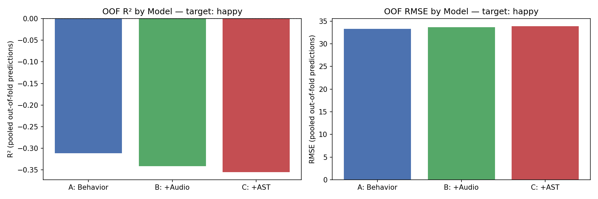

# Does What You Hear on TikTok Predict How You Feel?

An end-to-end ML pipeline testing whether the **audio content** of TikTok videos people watched in the 2 hours before an in-the-moment mood survey (EMA) predicts their well-being — beyond simple usage counts.

It links donated TikTok activity logs from **120 study participants** to the **~2,300 videos** they watched. It then extracts handcrafted signal-processing features (Librosa) and deep embeddings from a pretrained **Audio Spectrogram Transformer**, and compares nested Ridge models under participant-grouped cross-validation.

This work is part of a broader Harvard PhD research project on which features of short-form video content shape viewers' emotional and psychological states. Within that effort, this project's role is to test one candidate factor, audio, and rule it in or out, narrowing the search for what actually matters. All participant data is confidential and not included in this repository.

**Python · PyTorch · scikit-learn · Librosa · Audio Spectrogram Transformer · yt-dlp · pandas**

> **Result:** a well-powered **null finding**. Neither handcrafted audio nor deep AST embeddings add predictive signal for momentary well-being over behavioral counts (permutation test p = 0.92 and p = 0.42). Planning the sample size up front is what makes this a conclusive negative rather than an inconclusive one.

<p align="center">
  
</p>

---

## Highlights

- **Multimodal feature pipeline:** raw video URLs go through download, audio extraction, 264 Librosa features and 768-dim AST embeddings (via a forward hook on a pretrained transformer). The results are then aggregated to the survey level and joined to behavioral logs.
- **Leakage-safe evaluation:** Leave-One-Group-Out CV grouped by participant (120 folds), so no person's data appears on both sides of a split. All preprocessing (imputation, winsorizing, scaling, PCA) is fit inside each fold.
- **Power analysis before scaling up:** a noncentral-F power analysis showed the original 150-sample pilot had ~0% power. That led to rescaling to the full available data (~5× larger) and PCA-reducing the audio feature blocks to make the test detectable ([`analysis/power_analysis.py`](analysis/power_analysis.py)).
- **Significance testing:** a block permutation test checks whether each feature block's change in R² is distinguishable from chance ([`analysis/permutation_test.py`](analysis/permutation_test.py)).
- **Debugging at scale:** the first full run produced R² ≈ −47. I traced it to a single ~46-SD outlier that the linear model extrapolated on, and fixed it with fold-wise winsorization ([`analysis/modeling_utils.py`](analysis/modeling_utils.py)).
- **Production-style data collection:** a resumable, checkpointed, parallel pipeline (thread pool for network-bound downloads, process pool for CPU-bound feature extraction). It runs unattended overnight with a pre-flight health check and per-step logs ([`run_pipeline.sh`](run_pipeline.sh)).
- **Privacy by design:** no participant data is in this repo. The pipeline runs against an IRB-restricted dataset whose schema is documented in [`data/README.md`](data/README.md).

---

## Research Question

Do features of the audio people were exposed to on TikTok explain variance in their momentary well-being, beyond *how much* they used the app?

| Model | Features | # predictors (post-PCA) |
|---|---|---|
| **A** | Behavioral: TikTok views, likes, searches, shares, and app screen-time | 42 |
| **B** | A + handcrafted audio (Librosa, PCA-10) | 52 |
| **C** | B + deep audio embeddings (AST, PCA-30) | 82 |

Outcomes: momentary happiness, life satisfaction, social-media-use intention, and happiness during social media use.

---

## Results

N = 736 survey bursts from 120 participants. Out-of-fold metrics come from Leave-One-Group-Out CV.

| Outcome | A: Behavioral | B: + Handcrafted audio | C: + AST embeddings |
|---|---|---|---|
| `happy` (0–100) | R² = −0.311 · RMSE 33.32 | R² = −0.341 · RMSE 33.69 | R² = −0.356 · RMSE 33.88 |
| `life_satisfied` (0–100) | R² = −0.483 · RMSE 36.00 | R² = −0.517 · RMSE 36.41 | R² = −0.564 · RMSE 36.97 |
| `smu_intention_pc` | R² = −0.013 · RMSE 0.78 | R² = −0.027 · RMSE 0.78 | R² = −0.035 · RMSE 0.79 |
| `smu_experience_happy` (1–5) | R² = −0.283 · RMSE 1.20 | R² = −0.298 · RMSE 1.20 | R² = −0.321 · RMSE 1.21 |

**Permutation test** (`happy`, 100 permutations):

| Comparison | Observed ΔR² | p-value |
|---|---|---|
| A → B (add handcrafted audio) | −0.030 | 0.92 |
| B → C (add AST embeddings) | −0.014 | 0.42 |

**Interpretation:**
- R² is negative for every model, meaning that under participant-held-out CV no model beats predicting the mean for an unseen person.
- Each audio block makes predictions slightly *worse*, and neither change is distinguishable from chance.
- The power analysis gives ~75% power to detect even a small effect (Cohen's f² = 0.02) at this N, so a real small-to-medium effect would likely have appeared.
- Conclusion: at this scale, the audio content of recently watched videos carries no detectable signal about momentary well-being beyond usage behavior.

Full numbers are in [`results/ridge_results.json`](results/ridge_results.json), and all plots are in [`results/figures/`](results/figures/).

---

## Pipeline

```
Donated TikTok logs + EMA surveys (IRB-restricted, see data/README.md)
   │
   ├─ pipeline/sample_bursts.py           pick survey bursts + ≤5 watched-video URLs each
   ├─ pipeline/download_videos.py         parallel, resumable yt-dlp download
   ├─ pipeline/extract_audio_features.py  Librosa: MFCC, chroma, spectral, tonnetz, tempo… (multiprocess)
   ├─ pipeline/extract_ast_embeddings.py  768-dim Audio Spectrogram Transformer embeddings (MPS/CUDA/CPU)
   ├─ pipeline/build_features.py          join per-video feature tables
   └─ pipeline/build_model_dataset.py     aggregate to burst level, merge with behavior + outcomes
   │
   ├─ analysis/run_ridge_models.py        Models A/B/C × 4 outcomes, LOGO CV → results/ridge_results.json
   ├─ analysis/permutation_test.py        is ΔR² real or chance?
   ├─ analysis/power_analysis.py          how large does N need to be?
   └─ analysis/ridge_model.ipynb          walkthrough notebook + figures
```

**Audio features.** Librosa features are computed at 22.05 kHz. Each frame-level feature is summarized per video by mean, standard deviation, and volatility (std of frame-to-frame differences), giving 264 features. Details are in [`docs/audio_features.md`](docs/audio_features.md).

**Deep embeddings.** The [Audio Spectrogram Transformer](https://github.com/YuanGongND/ast), pretrained on AudioSet, produces a 768-dim embedding taken from the layer before classification. Only the model class is vendored, in [`third_party/ast/`](third_party/ast/) (BSD-3-Clause).

**Modeling.** Each fold runs mean imputation → winsorize to training-fold 5th/95th percentiles → StandardScaler → per-block PCA (audio: 10, AST: 30) → RidgeCV (α ∈ {0.01 … 1000}).

---

## Repository Layout

```
pipeline/        data collection + feature engineering (steps 1–6)
analysis/        modeling, permutation test, power analysis, notebook
results/         ridge_results.json + figures/
docs/            audio feature reference
data/            schema documentation only (all data is gitignored)
third_party/ast/ vendored Audio Spectrogram Transformer model class
run_pipeline.sh  unattended end-to-end runner
```

---

## Running It

The participant data cannot be shared. With equivalent data placed in `data/` (see [`data/README.md`](data/README.md)):

```bash
pip install -r requirements.txt          # plus a system ffmpeg

python pipeline/sample_bursts.py
python pipeline/download_videos.py
python pipeline/extract_audio_features.py
python pipeline/extract_ast_embeddings.py   # downloads AST weights on first run
python pipeline/build_features.py
python pipeline/build_model_dataset.py

python analysis/run_ridge_models.py
python analysis/permutation_test.py --comparison both --n-permutations 200
```

Or run the whole pipeline unattended with `bash run_pipeline.sh`; its header describes overnight use. `analysis/power_analysis.py` needs no data and runs as-is.

> **Note on downloads:** `curl_cffi` is required even though no code imports it directly. Without it, yt-dlp can't impersonate a browser's TLS fingerprint, and TikTok's bot detection rejects requests with a misleading *"Your IP address is blocked"* error.
